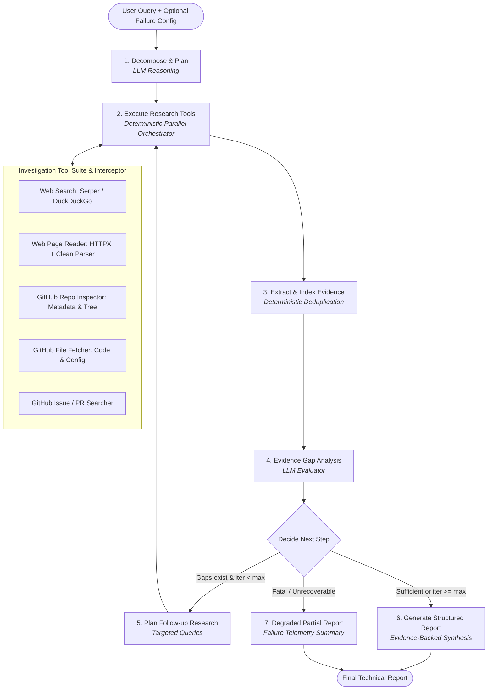

# Technical Research & Engineering Investigation Agent

The **Technical Research & Engineering Investigation Agent** is a stateful LangGraph workflow designed to autonomously investigate complex technical questions, perform deep repository inspections, analyze architecture patterns, and evaluate AI agent reliability.

---

## Architecture Overview



---

## Investigation Tools

| Tool | Implementation | Purpose |
|---|---|---|
| `web_search` | `app/core/langgraph/tools/research/web_search.py` | High-level discovery of articles, benchmark comparisons, and releases (Serper API with DuckDuckGo fallback). |
| `fetch_webpage` | `app/core/langgraph/tools/research/webpage_reader.py` | Extracts clean text/markdown from specific documentation and blog URLs. |
| `github_repo` | `app/core/langgraph/tools/research/github_repo.py` | Inspects stars, license, default branch, open issues count, and top-level directory structure. |
| `github_file` | `app/core/langgraph/tools/research/github_file.py` | Fetches raw code/config contents to verify actual implementation details. |
| `github_issue` | `app/core/langgraph/tools/research/github_issues.py` | Searches issues and PRs to investigate known reliability bugs and edge cases. |

---

## Model Configuration (OpenRouter Nemotron Free & Universal Pluggability)

The Research Agent uses a dedicated, pluggable service (`app/services/research_llm.py`) that is completely isolated from the template's default chat LLM service.

### OpenRouter Setup (Default: Nemotron 3 Ultra Free)
In your `.env` (or `.env.development`):
```env
OPENROUTER_API_KEY=your_openrouter_api_key_here
RESEARCH_MODEL_PROVIDER=openrouter
RESEARCH_MODEL_NAME=nvidia/nemotron-3-ultra-550b-a55b:free
RESEARCH_MODEL_BASE_URL=https://openrouter.ai/api/v1
RESEARCH_MODEL_REASONING_ENABLED=true
```

#### Automatic Free-Tier Resilience & Fallback Chain
Free models on OpenRouter can occasionally experience high queue concurrency or rate limits (HTTP 429). The `ResearchLLMService` automatically retries with exponential backoff and cascades through a backup chain of free models:
1. `nvidia/nemotron-3-ultra-550b-a55b:free` (Primary - with reasoning enabled)
2. `meta-llama/llama-3.3-70b-instruct:free` (Fallback 1)
3. `google/gemini-2.0-flash-exp:free` (Fallback 2)
4. `mistralai/mistral-small-24b-instruct-2501:free` (Fallback 3)

### Mistral / Other Providers
If you want to switch to Mistral or another provider later:
```env
# Example: Mistral AI
MISTRAL_API_KEY=your_mistral_api_key_here
RESEARCH_MODEL_PROVIDER=mistral
RESEARCH_MODEL_NAME=mistral-large-latest
RESEARCH_MODEL_BASE_URL=https://api.mistral.ai/v1

### Using Any Other Provider
Because the service uses a universal OpenAI-compatible client, you can switch to any other provider without touching Python code:
```env
# Example: DeepSeek
RESEARCH_MODEL_PROVIDER=custom
RESEARCH_MODEL_BASE_URL=https://api.deepseek.com/v1
RESEARCH_MODEL_NAME=deepseek-reasoner
RESEARCH_MODEL_API_KEY=your_deepseek_key

# Example: Local Ollama
RESEARCH_MODEL_PROVIDER=ollama
RESEARCH_MODEL_BASE_URL=http://localhost:11434/v1
RESEARCH_MODEL_NAME=llama3.3:70b
```

---

## Controlled Failure Injection Harness

The system includes a `FailureInjector` (`app/core/langgraph/failure_injector.py`) designed for reliability and observability benchmarking.

### Supported Failure Modes

1. **`timeout`**: Simulates external tool hanging or network partition.
2. **`rate_limit_429`**: Simulates HTTP 429 Too Many Requests (e.g., GitHub or search engine rate limits).
3. **`empty_response`**: Returns zero results to test how the planner recovers from search misses.
4. **`corrupted_data`**: Injects malformed/unparseable payloads to evaluate error handling in data extraction.
5. **`unsupported_claim`**: Injects synthetic hallucinations to test evaluation and critique guardrails.
6. **`infinite_loop_trigger`**: Artificially blocks sufficiency checks to test hard iteration limits and timeouts.

---

## API Endpoints

### 1. Normal Technical Investigation
`POST /api/v1/research/investigate`

```json
{
  "query": "Compare LangGraph vs CrewAI for production agent persistence and checkpointer implementations.",
  "max_iterations": 3
}
```

### 2. Reliability Experiment with Failure Injection
`POST /api/v1/research/experiment`

```json
{
  "query": "Investigate AutoGen tool retry policies and known issue discussions.",
  "max_iterations": 3,
  "failure_injection": {
    "failure_id": "exp_github_rate_limit_001",
    "target_tool": "github_file",
    "failure_mode": "rate_limit_429"
  }
}
```

---

## Observability & Telemetry

### Langfuse
- Full agent execution trace with node spans (`decompose_and_plan`, `execute_research`, `analyze_evidence`, `generate_report`).
- Child spans for each tool invocation.
- Tagged with `experiment_id` and `failure_mode`.

### Prometheus Metrics
Exposed at `/metrics`:
- `research_runs_total{status="completed|degraded|failed", failure_mode="..."}`
- `research_iterations_histogram`
- `research_tool_calls_total{tool="...", status="success|error|injected_failure"}`
- `research_evidence_collected_histogram`

